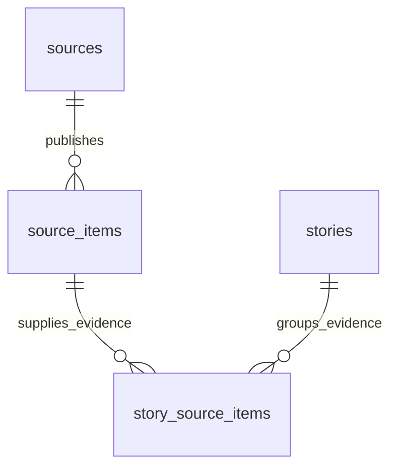

# Database foundation

Task 4A defines a Neon-compatible PostgreSQL schema and local migration infrastructure. Task 4B.4 verifies pooled and direct read-only access to the isolated Neon development endpoint. Task 4B.5 applies the checked-in initial migration to that development endpoint and validates the live catalog and constraints. **No migration has been applied to production, and the application still has no runtime query path.** The application continues to display its existing static shell.

## Dependencies and boundaries

Use stable Drizzle ORM 0.45.4, Drizzle Kit 0.31.11, and `@neondatabase/serverless` 1.2.0 with Node.js 24 and TypeScript 5.9.3. `server-only` 0.0.1 protects the application-facing entry point. The Neon driver supports one-shot HTTPS access through Drizzle's `neon-http` adapter and stateful direct sessions through `neon-serverless`; Node.js 24 supplies the WebSocket implementation used by the transactional migrator. No dotenv package, additional WebSocket package, ORM, or database test engine is installed.

- `src/server/db/schema.ts`: pure PostgreSQL declarations, Drizzle relations, and inferred select/insert types. Drizzle Kit reads this file directly; it must not import application code or credentials.
- `src/server/db/index.ts`: server-only application entry point. Future server code should import from here, never from a Client Component. Do not import the raw schema into client code.
- `src/server/db/environment.ts`: lazy `DATABASE_URL` reader that checks URL syntax/protocol/host/database without echoing the value. Importing it never reads credentials or initializes a connection. Task 4B.4 used a temporary credential-safe probe; no permanent application client was added.
- `drizzle.config.ts`: credential-free PostgreSQL generation configuration. It deliberately has no `dbCredentials` and does not load actual environment files.
- `drizzle/`: generated SQL, schema snapshot, and migration journal. These are reviewable source artifacts, not disposable build output.

## Tables and relationships



| Table | Purpose | Identity and important fields |
| --- | --- | --- |
| `sources` | Registered official feeds, publishers, engineering organizations, and communities | Generated UUID; unique stable `key`; unique registered `canonical_url`; name/kind; optional primary topic and reliability assessment; priority, active flag, ingestion cursor, last collection time |
| `source_items` | Individual articles, release notes, announcements, and discussions | Generated UUID; required source attribution; optional provider `external_id`; original and canonical URLs; title, optional kind/author/summary/topic; publication, first collection, and last-seen times; optional content hash; processing/retry fields; verification fields |
| `stories` | Distinct developments that may be reported by several publishers | Generated UUID; unique stable `deduplication_key`; title, optional summary/topic/development occurrence time; verification fields; archival timestamp |
| `story_source_items` | Many-to-many links between developments and their evidence | Composite primary key `(story_id, source_item_id)`; evidence role (`supports`, `contradicts`, or `context`), notes, link timestamp |

All tables have timezone-aware `created_at` and `updated_at`. Writers must set `updated_at` explicitly on mutation; defaults initialize new rows, and no SQL triggers or ORM update hooks are installed. A story's `occurred_at` differs from a publisher's `published_at`; neither is inferred from collection time. Unknown publication times, topics, item kinds, and reliability remain NULL rather than being invented.

The fourteen primary-topic values preserve the wider hub and public cloud niche. They are one optional primary category per record, not a complete future multi-topic taxonomy. New categories require reviewed enum migrations. Do not mix educational Style A/Style B with intelligence topics: independently categorized learning/content models remain future work.

## Constraints and indexes

- Foreign keys enforce source attribution and both evidence references. All use `ON DELETE RESTRICT` to prevent accidental removal of referenced evidence. Deactivate sources or archive stories; explicit deletions/removal of links need a later authorized retention policy.
- Source keys use lowercase hyphen-separated identifiers. Names, titles, deduplication keys, and non-NULL external IDs must not be blank.
- Reliability is optional and bounded 0–100. Priority is bounded 0–100 and defaults to neutral 50; higher values represent higher priority. Reliability scoring and collection prioritization algorithms are not implemented.
- Canonical URLs require an HTTP(S) prefix and a maximum of 2048 bytes. The bound keeps URL-based B-tree identity keys manageable. It is a deliberate initial limit, not full URL validation. Future ingestion must validate URLs, reject embedded credentials, normalize safely, and enforce SSRF/redirect/content-size restrictions before fetching.
- Unique item identities are `(source_id, external_id)` and `(source_id, canonical_url)`. PostgreSQL's default NULL-distinct uniqueness allows multiple items without external IDs while canonical-URL uniqueness still applies.
- Optional content hashes must be lowercase 64-character SHA-256 strings. The hash index is nonunique: identical/syndicated content from separate sources is a duplicate candidate, not an automatic deletion or a second independent corroboration.
- Processing attempt counts cannot be negative; last-seen time cannot precede first collection time. Pending/processed/failed/ignored states and attempt/retry/error fields prepare for operational processing without creating a scheduler or job system.
- An item or story marked `verified` must have a verification timestamp and nonblank notes. Explicit NULL checks prevent PostgreSQL CHECK's NULL semantics from bypassing this requirement.
- The evidence composite key prevents duplicate links. Its leading story ID supports story evidence lookup; a reverse item index supports finding related stories.
- Other indexes support source collection history, processing/retry selection, topic/publication feeds, topic/development queries, and verification-review queues. Revisit index needs with measured queries; no blanket indexes or premature search infrastructure.

Verification notes/timestamps do **not** prove factual accuracy. Cross-table checks such as a story having supporting evidence, source independence, and reviewer authorization must be enforced transactionally by the future verification service. PostgreSQL row CHECK constraints cannot enforce those cross-table policies here. Reviewer identity, an immutable verification audit trail, and content revisions remain planned.

## Deduplication and safe repeated ingestion

This task implements identity constraints, not an ingestion engine or canonicalization algorithm.

1. Preserve the discovered original URL; derive a canonical URL using a documented, source-aware normalization policy. Normalize scheme/host/default ports and remove fragments where appropriate. Do not blindly drop all query parameters or lowercase URL paths. The database compares stored canonical strings exactly.
2. Prefer a stable provider external ID when present, with the source-scoped canonical URL as an additional guard. Repeated collection must resolve conflicts without overwriting source identity, first collection time, or publication provenance. If the external ID and URL resolve to different existing rows, stop/quarantine the conflict rather than merge silently.
3. In a future transaction, upsert against reviewed identity rules, update last-seen/operational metadata, and advance the source cursor only after successful persistence. Unique constraints protect concurrent insert races; caller conflict handling is still required.
4. Store a stable story grouping key assigned by a reviewed deterministic policy. Titles are not unique and are not a sufficient semantic deduplication key. Exact story-key uniqueness prevents repeated creation; similarity-based story discovery remains planned.
5. Link evidence idempotently using the composite key. Preserve separate source attribution across publishers; content hashes and canonical URLs can flag possible syndication, not establish independence or verification.
6. Future workers need bounded retries/backoff, idempotent writes, controlled concurrency, timeouts/cancellation, atomic cursor advancement, and sanitized errors without credentials or response bodies. Changing evidence content must trigger a verification review; versioned snapshots are not implemented yet.

## Environment configuration

`DATABASE_URL` is the pooled server-only Neon URL intended for future application queries. `DATABASE_URL_UNPOOLED` is the direct server-only URL reserved for separately authorized migration or session-level work. `.env.example` contains empty placeholders only; no live URL is necessary for generation, offline tests, type checking, or builds. Actual `.env*` files remain ignored, with a narrow exception for `.env.example`. Never use `NEXT_PUBLIC_*` database variables or include credentials in configuration files, errors, migration files, logs, or client bundles.

The local `.env.local` contains both development connection settings and remains ignored and untracked. Task 4B.4 and Task 4B.5 parsed it only inside credential-safe temporary verification code and never displayed either value. The URLs matched the expected development endpoint and `neondb`. Task 4B.5 used only the direct value to execute the migration; it did not fall back to the pooler. Neither value was copied to Vercel, source files, or documentation.

## Migration workflow

With Node.js 24 active:

```sh
npm run db:generate -- --name=initial_intelligence
npm run db:check
npm run test:db
npm run lint
npm run typecheck
npm run build
```

Generated artifacts:

- `drizzle/0000_initial_intelligence.sql`: six enums, four tables, three foreign keys, eight explicit indexes, and associated unique/check/primary-key constraints.
- `drizzle/meta/0000_snapshot.json`: Drizzle's structural schema snapshot.
- `drizzle/meta/_journal.json`: the single initial migration entry.

Task 4A verification passed: generation and history checks, unchanged-schema regeneration with no new migration, seven offline database tests, ESLint, strict TypeScript, and the production build without a required `DATABASE_URL`. The local production server served all twelve routes successfully, and the thirteen existing HTTP regression checks passed, including unknown-route 404. Live PostgreSQL execution and constraint results are recorded in the Task 4B.5 section below.

The initial migration is generated from the schema into `drizzle/`. Review SQL together with the snapshot and journal. Running generation again without schema changes should produce no new migration. `db:check` checks migration history consistency; it does not connect to PostgreSQL, execute SQL, or prove runtime constraint behavior. The automated database tests validate lazy configuration/redacted failures and structural correspondence between declarations and generated artifacts. No test framework dependency is added.

For subsequent changes, edit the schema, generate a descriptively named migration, review SQL and data/backfill/locking implications, and preserve the journal/snapshots with the SQL. Apply only reviewed migrations through an explicitly authorized, credential-safe runner over a direct connection, validate them first on the isolated Neon development branch, and record the result. Rehearse recovery and backups before any separately authorized production change. Do not edit applied migrations or use `drizzle-kit push` for synchronization.

There is intentionally no committed `db:migrate`, `db:push`, startup migration, live application introspection, or automatic build/deployment migration. Task 4B.5 authorized only the recorded initial development-branch application. Future development or production changes require separate authorization; builds and application startup must never apply migrations implicitly.

## Deferred expansion and review decisions

Review the source-scoped identity rules, canonical-URL byte bound, 0–100 reliability/priority scales, deterministic story grouping policy, primary-topic taxonomy, and evidence-retention rules before ingestion implementation. These are proposed foundation conventions rather than a completed verification product.

Future tasks may add access control and personal preferences, feeds, bookmarks, digests, content drafts/memory, independent teaching categories, immutable provenance/review history, source fetch runs, and durable jobs. Add those tables only when their behavior is authorized. Data access and private hub information must remain server-side, with authorization before any private data is exposed through the currently public shell.

## Current tooling limitations

The production-only audit reports zero vulnerabilities. Full audit has nine development package findings: five existing high findings from braces and four moderate findings through Drizzle Kit's legacy loader to esbuild 0.18.20. The latter advisory affects esbuild's HTTP serve feature, not offline schema generation; no serve/Studio command is used. Patched esbuild 0.25.0 is outside the legacy loader's declared `~0.18.20` range. Track a compatible upstream stable fix, without forced Kit downgrades or unsupported overrides.

npm reported deprecated esbuild-kit loader packages and blocked three esbuild postinstall scripts. Generation/checks succeeded using installed native binaries; no extra script approval was needed. The built-in tests report Node's module-type detection warning for `.ts` ES-module imports in the existing mixed-module project. That warning remains visible; schema/application compilation is unchanged.

## Official references

- [Drizzle PostgreSQL schemas](https://orm.drizzle.team/docs/sql-schema-declaration)
- [Drizzle indexes and constraints](https://orm.drizzle.team/docs/indexes-constraints)
- [Drizzle generation](https://orm.drizzle.team/docs/drizzle-kit-generate)
- [Drizzle configuration](https://orm.drizzle.team/docs/drizzle-config-file)
- [Drizzle Neon connections](https://orm.drizzle.team/docs/connect-neon)
- [Neon serverless driver](https://github.com/neondatabase/serverless)
- [PostgreSQL constraints and NULL semantics](https://www.postgresql.org/docs/current/ddl-constraints.html)

## Resumed completion audit — 2026-10-13

Recovered the existing four-table schema, configuration, generated SQL/snapshot/journal, environment guard, dependencies, and tests without rebuilding them. The entire existing SQL now has a regression check against Drizzle's freshly generated initial DDL in memory. Seven database tests and thirteen local production route tests passed; offline regeneration created no additional migration, migration-history checking passed, and the existing SQL was not edited. Lint, strict type checking, and the Webpack production build passed without `DATABASE_URL`; the existing local environment file has no database URL entry. No driver, database connection, Neon resource, migration execution, commit, push, or deployment was introduced.

Fresh audits reconfirmed zero production findings and nine development package findings across the two documented advisories. Pre-existing lockfile package records remain semantically identical to HEAD. Git's histogram diff shows only the new dependency records and root manifest changes; large default diff output is repeated JSON matching noise, not unrelated upgrades. Review this local foundation before authorizing connection or ingestion work.

## Development connection verification — 2026-10-13

Task 4B.4 installed exact stable `@neondatabase/serverless` 1.2.0. Both local connection strings passed structural checks for PostgreSQL URL syntax, credentials, Neon host form, the expected endpoint identifier, the same host domain, and database name. The pooled host used `-pooler`; the direct host did not.

The same fixed query selected `current_database()`, `current_setting('server_version')`, and the integer `1` through each connection. Each execution used the driver's HTTP transaction API with `readOnly: true` and a 20-second cancellation signal. Both returned `neondb`, probe value `1`, and PostgreSQL 18.6. Fixed error messages intentionally withheld provider diagnostics that could contain sensitive connection details.

This verification executed only `SELECT` statements. It did not inspect schema objects, run the generated migration, use Drizzle Kit against Neon, or create/update/delete data. Temporary probe files remained outside the repository and were removed after verification. The application's database modules remain lazy and build-safe without environment variables.

## Development migration application — 2026-10-13

Task 4B.5 revalidated both local URLs and used the project owner's current Neon dashboard mapping of endpoint `ep-sweet-bread-b72xtg4u` to the `development` branch. Both URLs named `neondb`; the pooled host used the endpoint's `-pooler` form and the direct host used the exact non-pooler endpoint. Read-only probes succeeded on PostgreSQL 18.6 before any schema change. Preflight catalog inspection found only the provider-managed `neon_auth` schema plus an empty `public` schema, no planned-name conflicts, and no existing Drizzle history. The migration did not query or alter `neon_auth`.

The checked-in `drizzle/0000_initial_intelligence.sql` was byte-verified with SHA-256 `6e8821987f394954f59837b525345c03040b68f19ff339ba4810557d1a3f4a0e`, then applied over `DATABASE_URL_UNPOOLED` with `drizzle-orm/neon-serverless/migrator`. This supported path used one direct WebSocket pool connection and the PostgreSQL transactional migrator. It did not use `drizzle-kit push`, regenerate SQL, synchronize arbitrary schema state, read Vercel variables, or access the pooled URL as a migration fallback.

Read-only catalog comparison against `drizzle/meta/0000_snapshot.json` verified all 4 tables and 58 columns, all 6 enums and their ordered values, 4 primary keys, 5 unique constraints, 3 validated foreign keys with `ON DELETE RESTRICT` / `ON UPDATE NO ACTION`, 16 validated checks, 8 explicit indexes, and 9 primary/unique backing indexes. Column types, nullability, defaults, timestamp defaults, UUID defaults, index columns, and row-level-security state matched the snapshot. `drizzle.__drizzle_migrations` contains one row with the checked-in migration's checksum and journal timestamp.

Thirteen controlled integration scenarios passed inside an outer transaction: valid/defaulted source and item records; source-key uniqueness; reliability bounds; source-item external-ID and canonical-URL deduplication; foreign-key rejection; required details for verified stories; a valid verified story; one story linked to evidence from two different sources; duplicate evidence-link rejection; and restrictive deletion. The transaction was rolled back, and a separate read-only residue check found zero test records in all four tables.

A second invocation of the same Drizzle migrator completed without adding a history row or changing the catalog. The full catalog fingerprint remained `51e385431339b45e706ade37fd9382ffff945435a455345e6d78b70f848b57e7`, the migration-history row count remained one, and every application table remained empty. Production `main`, Vercel environment variables, authentication objects, application source, and deployment state were not accessed or modified.
