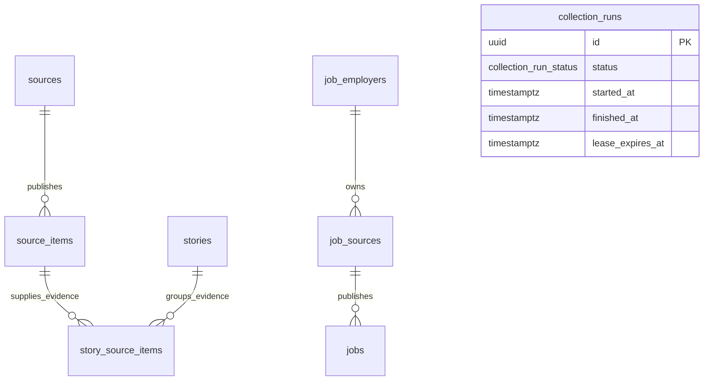

# Database foundation

Task 4A defines a Neon-compatible PostgreSQL schema and local migration infrastructure. Task 4B.5 and Task 4B.10 apply the initial migration to development and production. Task 7 adds durable collection monitoring, and Task 9 adds the Jobs & Opportunities model through a separate forward migration. The only application write route is the production-only, secret-authenticated news Cron handler; job population remains operator-only with no browser or public administrative write interface.

## Dependencies and boundaries

Use stable Drizzle ORM 0.45.4, Drizzle Kit 0.31.11, and `@neondatabase/serverless` 1.2.0 with Node.js 24 and TypeScript 5.9.3. `server-only` 0.0.1 protects the application-facing entry point. The Neon driver supports one-shot HTTPS access through Drizzle's `neon-http` adapter and stateful direct sessions through `neon-serverless`; Node.js 24 supplies the WebSocket implementation used by the transactional migrator. No dotenv package, additional WebSocket package, ORM, or database test engine is installed.

- `src/server/db/schema.ts`: pure PostgreSQL declarations, Drizzle relations, and inferred select/insert types. Drizzle Kit reads this file directly; it must not import application code or credentials.
- `src/server/db/index.ts`: server-only application entry point. Future server code should import from here, never from a Client Component. Do not import the raw schema into client code.
- `src/server/db/environment.ts`: lazy `DATABASE_URL` reader that checks URL syntax/protocol/host/database without echoing the value. Importing it never reads credentials or initializes a connection.
- `src/server/db/client.ts`: lazy application client factory using Drizzle's Neon HTTP adapter. It reads the pooled `DATABASE_URL` only when a server request invokes a query and applies a 15-second abort signal. It does not connect at module load or during builds.
- `drizzle.config.ts`: credential-free PostgreSQL generation configuration. It deliberately has no `dbCredentials` and does not load actual environment files.
- `drizzle/`: generated SQL, schema snapshot, and migration journal. These are reviewable source artifacts, not disposable build output.

## Tables and relationships



| Table | Purpose | Identity and important fields |
| --- | --- | --- |
| `sources` | Registered official feeds, publishers, engineering organizations, and communities | Generated UUID; unique stable `key`; unique registered `canonical_url`; name/kind; optional primary topic and reliability assessment; priority, active flag, ingestion cursor, last collection time |
| `source_items` | Individual articles, release notes, announcements, and discussions | Generated UUID; required source attribution; optional provider `external_id`; original and canonical URLs; title, optional kind/author/summary/topic; publication, first collection, and last-seen times; optional content hash; processing/retry fields; verification fields |
| `job_employers` | Verified employer identities | Generated UUID; unique slug and website; careers verification URL; verification and audit timestamps |
| `job_sources` | Employer recruiting boards or authorized publishing sources | Generated UUID; restrictive employer FK; provider plus external-board identity; unique canonical URL; active and verification metadata |
| `jobs` | Public vacancies and their permitted summarized metadata | Generated UUID; restrictive source FK; unique source/external identity, slug, and listing URL; category and specialization; nullable work, geography, salary, date, qualification, and eligibility fields; status, verification evidence, content hash, and audit timestamps |
| `stories` | Distinct developments that may be reported by several publishers | Generated UUID; unique stable `deduplication_key`; title, optional summary/topic/development occurrence time; verification fields; archival timestamp |
| `story_source_items` | Many-to-many links between developments and their evidence | Composite primary key `(story_id, source_item_id)`; evidence role (`supports`, `contradicts`, or `context`), notes, link timestamp |
| `collection_runs` | Durable monitoring and concurrency state for scheduled/manual collection | Generated UUID; trigger/status; bounded lease token/expiry; start/finish times; processed and failed source keys; inserted/updated/unchanged counts; safe failure code |

All tables have timezone-aware `created_at` and `updated_at`. Writers must set `updated_at` explicitly on mutation; defaults initialize new rows, and no SQL triggers or ORM update hooks are installed. A story's `occurred_at` differs from a publisher's `published_at`; neither is inferred from collection time. Unknown publication times, topics, item kinds, and reliability remain NULL rather than being invented.

The fourteen primary-topic values preserve the wider hub and public cloud niche. They are one optional primary category per record, not a complete future multi-topic taxonomy. New categories require reviewed enum migrations. Do not mix educational Style A/Style B with intelligence topics: independently categorized learning/content models remain future work.

## Constraints and indexes

- Foreign keys enforce source attribution and both evidence references. All use `ON DELETE RESTRICT` to prevent accidental removal of referenced evidence. Deactivate sources or archive stories; explicit deletions/removal of links need a later authorized retention policy.
- Source keys use lowercase hyphen-separated identifiers. Names, titles, deduplication keys, and non-NULL external IDs must not be blank.
- Reliability is optional and bounded 0–100. Priority is bounded 0–100 and defaults to neutral 50; higher values represent higher priority. Reliability scoring and collection prioritization algorithms are not implemented.
- Canonical URLs require an HTTP(S) prefix and a maximum of 2048 bytes. The bound keeps URL-based B-tree identity keys manageable. It is a deliberate initial limit, not full URL validation. Future ingestion must validate URLs, reject embedded credentials, normalize safely, and enforce SSRF/redirect/content-size restrictions before fetching.
- Unique item identities are `(source_id, external_id)` and `(source_id, canonical_url)`. PostgreSQL's default NULL-distinct uniqueness allows multiple items without external IDs while canonical-URL uniqueness still applies.
- Optional content hashes must be lowercase 64-character SHA-256 strings. The hash index is nonunique: identical/syndicated content from separate sources is a duplicate candidate, not an automatic deletion or a second independent corroboration.
- Processing attempt counts cannot be negative; last-seen time cannot precede first collection time. Collection-run counts and source-key arrays must agree, completion cannot precede start, and only a `running` row may hold a lease.
- A partial unique index permits one `running` collection row at a time. A 240-second lease bounds crash recovery; the next invocation marks an expired lease failed before acquiring a new one. Completion checks and locks the active token in the same transaction as article persistence, so a late worker cannot commit after losing its lease.
- An item or story marked `verified` must have a verification timestamp and nonblank notes. Explicit NULL checks prevent PostgreSQL CHECK's NULL semantics from bypassing this requirement.
- The evidence composite key prevents duplicate links. Its leading story ID supports story evidence lookup; a reverse item index supports finding related stories.
- Other indexes support source collection history, processing/retry selection, topic/publication feeds, topic/development queries, and verification-review queues. Revisit index needs with measured queries; no blanket indexes or premature search infrastructure.

Verification notes/timestamps do **not** prove factual accuracy. Cross-table checks such as a story having supporting evidence, source independence, and reviewer authorization must be enforced transactionally by the future verification service. PostgreSQL row CHECK constraints cannot enforce those cross-table policies here. Reviewer identity, an immutable verification audit trail, and content revisions remain planned.

## Deduplication and safe repeated ingestion

Task 6 implements the first bounded identity and canonicalization policy:

1. Preserve the discovered original URL; derive a canonical URL using a documented, source-aware normalization policy. Normalize scheme/host/default ports and remove fragments where appropriate. Do not blindly drop all query parameters or lowercase URL paths. The database compares stored canonical strings exactly.
2. Prefer a stable provider external ID when present, with the source-scoped canonical URL as an additional guard. Repeated collection must resolve conflicts without overwriting source identity, first collection time, or publication provenance. If the external ID and URL resolve to different existing rows, stop/quarantine the conflict rather than merge silently.
3. The operator transaction inserts missing items, advances last-seen time, and updates changed publisher metadata while preserving first collection and original URL. It does not advance a cursor because these initial feeds provide no reviewed cursor contract. Unique constraints protect concurrent insert races, and a final identity pass verifies the batch.
4. Store a stable story grouping key assigned by a reviewed deterministic policy. Titles are not unique and are not a sufficient semantic deduplication key. Exact story-key uniqueness prevents repeated creation; similarity-based story discovery remains planned.
5. Link evidence idempotently using the composite key. Preserve separate source attribution across publishers; content hashes and canonical URLs can flag possible syndication, not establish independence or verification.
6. Fetching uses bounded concurrency, timeouts/cancellation, response limits, idempotent writes, and sanitized errors. Task 7 adds one bounded retry for failed publishers and durable run history. Atomic cursor advancement, versioned content snapshots, and verification-review invalidation remain future work.

## Technology Sources Catalog — Task 5

The first runtime feature reads only `key`, `name`, `canonical_url`, `kind`, `primary_topic`, `description`, and `is_active` from `sources`. `src/server/sources/list-sources.ts` applies validated text/topic/type/status filters, parameterized Drizzle conditions, deterministic ordering, and a 100-row maximum. Provider failures become a fixed safe application error. The page calls Next.js `connection()` before the query, so the database is reached only for a real request. Results are intentionally uncached in this first version; each request reads current catalog state. Revisit short revalidation only after authenticated administration creates a reliable invalidation policy.

Twelve first-party sources are registered in Neon `development` and production `main`: AWS Architecture Blog, Microsoft Azure Blog, Google Cloud Blog, Linux Kernel Archives, Cloudflare Blog, Kubernetes Blog, Cloud Native Computing Foundation Blog, HashiCorp Blog, NIST Cybersecurity Insights, GitHub Engineering, NVIDIA Technical Blog, and Cisco Security Advisories. Only verified public website URLs are stored. The schema has no feed URL field, so feed endpoints remain reviewed server configuration. Reliability scores and ingestion cursors remain unset.

`scripts/source-catalog-seed.mjs` is operator-only tooling, not an application endpoint or build hook. Development requires the exact direct development endpoint from ignored `.env.local`. Production reuses the dedicated ignored `0600` production migration credential, exact direct production endpoint allowlist, and a source-specific interactive confirmation. Both modes verify the applied migration and catalog conflicts before writes. Registration is insert-only with `ON CONFLICT DO NOTHING`; exact repeats insert zero rows, while conflicting keys or canonical URLs stop the transaction. The script fingerprints `neon_auth` and verifies non-source application table counts around writes. It never migrates schemas, exposes credentials, or creates public write APIs.

## Technology news collection — Task 6

Task 6 established six reviewed feeds mapped to AWS Architecture, Google Cloud, Cloudflare, Kubernetes, CNCF, and HashiCorp. Task 8 adds Azure Blog, Linux Kernel Archives, Cisco Security Advisories, GitHub Engineering, NIST Cybersecurity Insights, and NVIDIA Technical Blog. Feed endpoints remain typed server configuration because the current schema intentionally has no feed URL field.

The official Linux `kdist.xml` feed gives every entry the same homepage link. The collector accepts only stable and long-term entries that embed an official, version-matched `cdn.kernel.org/.../ChangeLog-*` URL. It uses that feed-provided release note as the original/canonical link and retains the provider GUID. Mainline and linux-next entries without a matching changelog are rejected; no URL is synthesized from a title or version.

Each successful feed contributes at most 20 items. The collector stores only title, bounded plain-text summary, optional author, provider external ID, approved original/canonical URL, topic, article kind, source attribution, publication time, collection time, and last-seen time. It leaves verification status at `unverified`, creates no story or evidence row, stores no full article body, and does not infer reliability. URL fragments are removed; paths and query parameters otherwise remain publisher-controlled and case-preserving.

Before a write, both external-ID and canonical-URL matches are resolved. If they point to different rows, or an established identity changes URL/ID incompatibly, the transaction stops. Repeats update last-seen time and only change mutable publisher metadata when necessary. The first successful run stored 110 items in development and 110 in production; the second development run inserted zero, updated zero, and recognized all 110. Six source `last_collected_at` values record successful batch completion. `stories` and `story_source_items` remain empty.

`scripts/news-ingestion.mjs` loads only ignored, permission-restricted direct credentials, validates the exact selected endpoint/database and both applied migration records, requires at least eight successful reviewed feeds, and fingerprints managed authentication objects across production writes. It reuses the same retry, PostgreSQL lease, persistence, and durable run-record path as Cron. Production requires `--execute` and `INGEST APPROVED NEWS INTO NEON MAIN ep-spring-grass-b7iye83x` in a TTY. The command is absent from install/build/start/Vercel configuration and never runs a migration.

`src/server/news/list-news.ts` joins `source_items` to `sources`, validates filters, orders by publication time with collection fallback, and caps output at 100. `/stories` calls `connection()` before the uncached query, so builds remain credential-free. Errors become a fixed public state without provider diagnostics. There is no browser database client, ingestion Server Action, or public administrative write endpoint.

## Automatic collection and monitoring — Task 7

Vercel Cron invokes `GET /api/cron/news` once daily using `0 6 * * *` in UTC. Hobby scheduling has hourly precision, so a run may begin between 06:00 and 06:59 UTC. The handler runs only when both Vercel's production indicators and a production-scoped `CRON_SECRET` are present. Missing configuration fails closed, invalid authorization returns 401, preview/local requests do no work, and responses/logs never contain credentials or provider diagnostics.

The handler reuses the allowlisted fetcher, parser, identity planner, and shared transactional persistence. Twelve feeds run with concurrency two, 15-second request limits, two redirects, a 2 MiB response cap, at most 20 items each, a combined 210-item configuration ceiling, and one 750 ms retry for only the sources that failed. The theoretical two-pass network timeout window is 180.75 seconds. The route has a 225-second internal cancellation budget within Vercel Hobby's 300-second Fluid Compute limit and the 240-second database lease. Unchanged rows are touched in one bounded update per publisher rather than one statement per article.

Each invocation records `running`, `succeeded`, `partially_succeeded`, `failed`, or `skipped`, processed/failed source keys, item outcomes, and timestamps. Publisher failure details remain private; only fixed failure codes are stored. Stories & News exposes only the last fully successful completion time. A partial run is visible operationally but is not presented as a successful freshness timestamp. Vercel does not retry failed Cron invocations, so the next daily run recovers expired leases and retries publisher requests within its own bounded execution.

The controlled production invocation on 2026-10-14 processed all six publishers, inserted one newly published item, recognized 109 unchanged items, and completed successfully. Production then contained 111 source items, one completed run, zero active leases, and zero duplicate identity groups. An unauthenticated request returned 401 and created no run record. This controlled invocation proves the deployed route; it is not evidence that the first platform-scheduled window has occurred.

Task 8 development verification processed all 12 publishers and 182 current feed entries. The initial expanded run added 75 genuine items; a later repeat against the same current feed window inserted zero and recognized 182 unchanged identities. The measured guarded repeat completed in about 55 seconds. The single daily Cron definition and secret-authenticated route are unchanged.

The guarded Task 8 production run processed all 12 publishers successfully, inserted 74 new items, recognized 108 unchanged current identities, and completed its leased collection phase in 12.253 seconds. Production now has 12 sources and 185 collected items, with zero duplicate identity groups, zero active leases, zero stories/evidence links, two matching migrations, and all nine managed authentication tables preserved.

## Environment configuration

`DATABASE_URL` is the pooled server-only Neon URL used for application queries and scheduled transactions. `DATABASE_URL_UNPOOLED` is the direct server-only URL reserved for separately authorized migration or session-level work. `CRON_SECRET` is a production-only Vercel Secret used solely for Cron authorization. `.env.example` contains empty placeholders only; no live value is necessary for generation, offline tests, type checking, or builds. Actual `.env*` files remain ignored, with a narrow exception for `.env.example`. Never use `NEXT_PUBLIC_*` database or Cron variables or include credentials in configuration files, errors, migration files, logs, or client bundles.

The local `.env.local` contains both development connection settings and remains ignored and untracked. The URLs match the expected development endpoint and `neondb`. Runtime Sources/Stories reads use pooled `DATABASE_URL`; guarded administrative registration and ingestion use the direct value. Production administration reuses only the dedicated production credential file. No value is copied to source files or documentation.

## Migration workflow

With Node.js 24 active:

```sh
npm run db:generate -- --name=initial_intelligence
npm run db:check
npm run test:db
npm run lint
npm run typecheck
npm run build
```

Generated artifacts:

- `drizzle/0000_initial_intelligence.sql`: six enums, four tables, three foreign keys, eight explicit indexes, and associated unique/check/primary-key constraints.
- `drizzle/meta/0000_snapshot.json`: Drizzle's structural schema snapshot.
- `drizzle/0001_collection_runs.sql`: two collection enums, one monitoring/lease table, four checks, one partial unique lease index, and two query indexes.
- `drizzle/meta/0001_snapshot.json`: the post-Task 7 structural snapshot.
- `drizzle/meta/_journal.json`: ordered initial and collection-monitoring migration entries.

Task 4A verification passed: generation and history checks, unchanged-schema regeneration with no new migration, seven offline database tests, ESLint, strict TypeScript, and the production build without a required `DATABASE_URL`. The local production server served all twelve routes successfully, and the thirteen existing HTTP regression checks passed, including unknown-route 404. Live PostgreSQL execution and constraint results are recorded in the Task 4B.5 section below.

The initial migration is generated from the schema into `drizzle/`. Review SQL together with the snapshot and journal. Running generation again without schema changes should produce no new migration. `db:check` checks migration history consistency; it does not connect to PostgreSQL, execute SQL, or prove runtime constraint behavior. The automated database tests validate lazy configuration/redacted failures and structural correspondence between declarations and generated artifacts. No test framework dependency is added.

For subsequent changes, edit the schema, generate a descriptively named migration, review SQL and data/backfill/locking implications, and preserve the journal/snapshots with the SQL. Apply only reviewed migrations through an explicitly authorized, credential-safe runner over a direct connection, validate them first on the isolated Neon development branch, and record the result. Rehearse recovery and backups before any separately authorized production change. Do not edit applied migrations or use `drizzle-kit push` for synchronization.

There is no general-purpose `db:migrate`, `db:push`, startup migration, live application introspection, or automatic build/deployment migration. Task 4B.5 authorized only the recorded initial development-branch application. Task 4B.9 adds the guarded production-only procedure below, but does not authorize or execute it. Future database changes still require separate authorization; builds and application startup must never apply migrations implicitly.

## Production migration procedure

Task 4B.9 added the operator-only production runner, and Task 4B.10 used it for the first production migration. The runner is separate from `drizzle.config.ts`, is never called by install, build, start, or deployment scripts, and accepts credentials only from ignored `.env.production-migration.local`. It does not read `.env.local`, `DATABASE_URL`, `DATABASE_URL_UNPOOLED`, Vercel variables, CLI arguments, or inherited environment values. The dedicated file must be a regular non-symlink file with mode `0600` and contain exactly one entry:

```dotenv
PRODUCTION_DATABASE_URL_UNPOOLED=<direct Neon main connection URL>
```

The URL validator requires PostgreSQL over TLS, database `neondb`, a direct hostname without `-pooler`, and the exact verified production endpoint `ep-spring-grass-b7iye83x`. The known development endpoint is rejected explicitly. The exact production allowlist also rejects the recovery checkpoint and every other endpoint even though their identifiers are not needed by the runner. Connection options that could change `search_path` are rejected.

The only eligible SQL is `drizzle/0000_initial_intelligence.sql`, SHA-256 `6e8821987f394954f59837b525345c03040b68f19ff339ba4810557d1a3f4a0e`, with journal tag `0000_initial_intelligence` and timestamp `1791844748241`. These values match the artifact applied and tested on development. Any byte or journal change stops the runner. The reviewed SQL contains only the six enums, four application tables, their constraints, and eight explicit indexes. It contains no `neon_auth` reference. Drizzle itself creates only `drizzle.__drizzle_migrations` for history.

Use this sequence only in a later task that explicitly authorizes the production write:

1. Reconfirm through authoritative Neon metadata that `main` still owns direct endpoint `ep-spring-grass-b7iye83x`, the recovery checkpoint still exists, and the production baseline remains zero `public` application tables, no Drizzle history, and nine managed authentication tables. Confirm a clean Git checkout at the reviewed commit and activate Node.js 24.
2. Create the dedicated file without placing the URL in shell history: run `umask 077`, open `.env.production-migration.local` in a local editor, add the single variable, save it, and run `chmod 600 .env.production-migration.local`. Git's `.env*` rule ignores it, and the runner independently checks that exclusion.
3. Run the normal offline checks, then run `npm run db:migrate:production:preflight`. This mode validates the credential, migration checksum/journal, database, empty application catalog, absent Drizzle history, safe search path, and nine-table `neon_auth` baseline inside read-only transactions. It cannot reach migration execution.
4. Stop and review the preflight result. After separate approval to modify production, run `npm run db:migrate:production -- --execute` in an interactive terminal. The runner repeats all safeguards and requires the operator to type `APPLY INITIAL MIGRATION TO NEON MAIN ep-spring-grass-b7iye83x` exactly. A flag, piped input, CI job, or noninteractive shell cannot substitute for that confirmation.
5. On confirmation, the runner rechecks the catalog state, pins the same acquired direct session to `public`, and invokes `drizzle-orm/neon-serverless/migrator` with the checked-in `drizzle/` folder. It explicitly sets the history target to `drizzle.__drizzle_migrations`; it never uses `drizzle-kit push` or schema synchronization.
6. The runner then verifies the four tables, six enums, four primary keys, five unique constraints, sixteen checks, three validated restrictive foreign keys, eight explicit indexes, single matching history row, and empty application tables. It compares the `neon_auth` table/column/constraint/index catalog fingerprint before and after. Remove the dedicated credential file after the result has been reviewed.

If an error occurs after the write phase starts, do not rerun automatically. Inspect the production catalog and Drizzle history against the recovery checkpoint first. Drizzle creates its history schema/table before its transactional application-DDL block, so a failed run may leave an empty history table even when application DDL rolled back. Production recovery, retry, or branch restoration requires a separate decision.

### Initial production result — 2026-10-14

The read-only preflight connected through the dedicated direct credential to verified production endpoint `ep-spring-grass-b7iye83x`, database `neondb`. It found the expected empty application catalog, absent Drizzle history, safe search path, and nine-table managed `neon_auth` baseline. The existing `pre-initial-migration` recovery checkpoint remained the verified recovery boundary and was not modified.

After the required interactive confirmation, the runner applied only `drizzle/0000_initial_intelligence.sql` with SHA-256 `6e8821987f394954f59837b525345c03040b68f19ff339ba4810557d1a3f4a0e`. Built-in before/after comparison confirmed that the `neon_auth` table, column, constraint, and index catalog fingerprint did not change.

An independent read-only catalog pass verified 4 application tables, 58 columns, 6 enums, 4 primary keys, 5 unique constraints, 16 validated checks, 3 validated foreign keys with `ON DELETE RESTRICT` and `ON UPDATE NO ACTION`, and 17 total indexes including all 8 explicit indexes. `drizzle.__drizzle_migrations` has one row matching the migration checksum and journal timestamp. All four application tables contain zero rows. The existing history timestamp means Drizzle's normal migration workflow skips this migration on a repeat run rather than recreating objects.

No development or recovery branch object was changed. No test records were inserted. Production deployment builds and application startup remain migration-free, and current pages still do not connect to PostgreSQL.

## Deferred expansion and review decisions

Review the source-scoped identity rules and canonicalization policy before adding publishers whose feeds use mutable or nonunique links. Reliability/priority scales, deterministic story grouping, the primary-topic taxonomy, evidence retention, and verification audit history still require review before those features expand. The collected feed is not a completed verification product.

Future tasks may add access control and personal preferences, feeds, bookmarks, digests, content drafts/memory, independent teaching categories, immutable provenance/review history, recurring job-discovery runs, and private marketplace data. Add those tables only when their behavior is authorized. Data access and private hub information must remain server-side, with authorization before any private data is exposed through the currently public shell.

## Jobs migration and initial catalog — 2026-10-14

`drizzle/0002_jobs_opportunities.sql` is a forward-only additive migration containing 3 tables, 7 enums, 58 columns, 34 named constraints, and 8 explicit query indexes. Its checksum is locked by operator tooling and it does not reference `neon_auth`. Development and production each contain the exact third Drizzle history record. The migration inserted no data and preserved all existing application row counts and the nine-table managed authentication catalog.

The initial catalog contains 4 employers, 4 authorized recruiting sources, and 11 currently open vacancies. The importer validates exact Greenhouse, Ashby, and Lever identities immediately before a write, uses source/external ID plus slug and listing URL for conflict detection, and stores a deterministic content hash. A development repeat inserted zero rows; the production postflight reports all 11 retained with no pending inserts. Jobs without disclosed salary, deadline, publication date, experience, or employment type keep those columns null.

Migration execution and catalog insertion are separate explicit commands. Both environments require exact direct endpoints and the reviewed three-record history. Production reads only `.env.production-migration.local`, requires mode `0600`, and prompts for an endpoint-bearing confirmation. The importer does not delete records, run migrations, modify news data, or access `neon_auth`. Ordinary `npm ci`, builds, application imports, page requests, the existing daily Cron, and Vercel deployment do not call either tool.

## Automated job discovery — 2026-10-15

`drizzle/0003_job_discovery.sql` is a forward-only additive migration. It creates `job_discovery_runs` and `job_closure_reason`, adds three sync-health columns to `job_sources`, and adds six lifecycle columns plus a status/check-time index to `jobs`. The reviewed artifact contains 20 statements and SHA-256 `8f25b15f4bead848ebfd4bfd4cd4afc5ecd50c5a70baae7279dea17d31c8e891`. Development and production each contain its exact fourth Drizzle history record. Existing rows, source/news data, and the nine-table managed `neon_auth` catalog were preserved.

`job_discovery_runs` records trigger, state, timing, attempted/successful/failed source keys, relevant jobs discovered, insert/update/verified/unchanged/pending/closed counts, and fixed safe failure codes. A partial unique index allows one `running` row. The writer owns a UUID lease for 240 seconds; an invocation can mark an expired lease failed and continue, while an overlapping invocation records `skipped`. Job monitoring remains separate from `collection_runs` so news and vacancy metrics retain their own meaning.

Each vacancy now records `last_seen_at`, `last_checked_at`, a consecutive missing-observation count and first-missing time, plus closure time/reason. A job present on a successful board resets missing evidence and returns to open. One complete-board absence becomes `unverified`; a second consecutive complete-board absence becomes `closed`. A disclosed elapsed deadline can produce `expired`. Failed, timed-out, rate-limited, malformed, oversized, or otherwise incomplete source retrieval leaves every vacancy for that source unchanged.

Development migration and discovery validation completed first. After correcting an over-broad initial deterministic match, a bounded development repair removed only 163 Task 10 records that did not pass the final title/domain rule and preserved the 11 Task 9 records. The stable development catalog is 483 records; the final repeat reported 0 inserted, 0 updated, 483 unchanged, and zero duplicate identities. The interrupted test run demonstrated an active-lease skip and later expired-lease recovery.

Production preflight required the exact direct endpoint, four reviewed history records after migration, database `neondb`, safe search path, and the nine-table Auth baseline. The guarded manual run processed all seven sources, inserted 472 vacancies, updated the existing 11, and marked none closed or pending. Read-only postflight found 483 open rows, 483 distinct `(source_id, external_id)` identities, 483 slugs, and 483 listing URLs. It also confirmed all nine Neon Auth tables and news counts remained unchanged.

The runtime Cron uses pooled `DATABASE_URL`; operator migration and controlled manual discovery use only exact direct credentials. No install, build, page request, or deployment script invokes migration tooling. `CRON_SECRET` remains a server-only Vercel production secret and no database write endpoint accepts public parameters.

## Current tooling limitations

The production-only audit reports zero vulnerabilities, including current stable `fast-xml-parser` 5.11.2. Full audit has nine development package findings: five existing high findings from braces and four moderate findings through Drizzle Kit's legacy loader to esbuild 0.18.20. The latter advisory affects esbuild's HTTP serve feature, not offline schema generation; no serve/Studio command is used. Patched esbuild 0.25.0 is outside the legacy loader's declared `~0.18.20` range. Track a compatible upstream stable fix, without forced Kit downgrades or unsupported overrides.

npm reported deprecated esbuild-kit loader packages and blocked three esbuild postinstall scripts. Generation/checks succeeded using installed native binaries; no extra script approval was needed. The built-in tests report Node's module-type detection warning for `.ts` ES-module imports in the existing mixed-module project. That warning remains visible; schema/application compilation is unchanged.

## Official references

- [Drizzle PostgreSQL schemas](https://orm.drizzle.team/docs/sql-schema-declaration)
- [Drizzle indexes and constraints](https://orm.drizzle.team/docs/indexes-constraints)
- [Drizzle generation](https://orm.drizzle.team/docs/drizzle-kit-generate)
- [Drizzle configuration](https://orm.drizzle.team/docs/drizzle-config-file)
- [Drizzle Neon connections](https://orm.drizzle.team/docs/connect-neon)
- [Neon serverless driver](https://github.com/neondatabase/serverless)
- [PostgreSQL constraints and NULL semantics](https://www.postgresql.org/docs/current/ddl-constraints.html)

## Resumed completion audit — 2026-10-13

Recovered the existing four-table schema, configuration, generated SQL/snapshot/journal, environment guard, dependencies, and tests without rebuilding them. The entire existing SQL now has a regression check against Drizzle's freshly generated initial DDL in memory. Seven database tests and thirteen local production route tests passed; offline regeneration created no additional migration, migration-history checking passed, and the existing SQL was not edited. Lint, strict type checking, and the Webpack production build passed without `DATABASE_URL`; the existing local environment file has no database URL entry. No driver, database connection, Neon resource, migration execution, commit, push, or deployment was introduced.

Fresh audits reconfirmed zero production findings and nine development package findings across the two documented advisories. Pre-existing lockfile package records remain semantically identical to HEAD. Git's histogram diff shows only the new dependency records and root manifest changes; large default diff output is repeated JSON matching noise, not unrelated upgrades. Review this local foundation before authorizing connection or ingestion work.

## Development connection verification — 2026-10-13

Task 4B.4 installed exact stable `@neondatabase/serverless` 1.2.0. Both local connection strings passed structural checks for PostgreSQL URL syntax, credentials, Neon host form, the expected endpoint identifier, the same host domain, and database name. The pooled host used `-pooler`; the direct host did not.

The same fixed query selected `current_database()`, `current_setting('server_version')`, and the integer `1` through each connection. Each execution used the driver's HTTP transaction API with `readOnly: true` and a 20-second cancellation signal. Both returned `neondb`, probe value `1`, and PostgreSQL 18.6. Fixed error messages intentionally withheld provider diagnostics that could contain sensitive connection details.

This verification executed only `SELECT` statements. It did not inspect schema objects, run the generated migration, use Drizzle Kit against Neon, or create/update/delete data. Temporary probe files remained outside the repository and were removed after verification. The application's database modules remain lazy and build-safe without environment variables.

## Development migration application — 2026-10-13

Task 4B.5 revalidated both local URLs and used the project owner's current Neon dashboard mapping of endpoint `ep-sweet-bread-b72xtg4u` to the `development` branch. Both URLs named `neondb`; the pooled host used the endpoint's `-pooler` form and the direct host used the exact non-pooler endpoint. Read-only probes succeeded on PostgreSQL 18.6 before any schema change. Preflight catalog inspection found only the provider-managed `neon_auth` schema plus an empty `public` schema, no planned-name conflicts, and no existing Drizzle history. The migration did not query or alter `neon_auth`.

The checked-in `drizzle/0000_initial_intelligence.sql` was byte-verified with SHA-256 `6e8821987f394954f59837b525345c03040b68f19ff339ba4810557d1a3f4a0e`, then applied over `DATABASE_URL_UNPOOLED` with `drizzle-orm/neon-serverless/migrator`. This supported path used one direct WebSocket pool connection and the PostgreSQL transactional migrator. It did not use `drizzle-kit push`, regenerate SQL, synchronize arbitrary schema state, read Vercel variables, or access the pooled URL as a migration fallback.

Read-only catalog comparison against `drizzle/meta/0000_snapshot.json` verified all 4 tables and 58 columns, all 6 enums and their ordered values, 4 primary keys, 5 unique constraints, 3 validated foreign keys with `ON DELETE RESTRICT` / `ON UPDATE NO ACTION`, 16 validated checks, 8 explicit indexes, and 9 primary/unique backing indexes. Column types, nullability, defaults, timestamp defaults, UUID defaults, index columns, and row-level-security state matched the snapshot. `drizzle.__drizzle_migrations` contains one row with the checked-in migration's checksum and journal timestamp.

Thirteen controlled integration scenarios passed inside an outer transaction: valid/defaulted source and item records; source-key uniqueness; reliability bounds; source-item external-ID and canonical-URL deduplication; foreign-key rejection; required details for verified stories; a valid verified story; one story linked to evidence from two different sources; duplicate evidence-link rejection; and restrictive deletion. The transaction was rolled back, and a separate read-only residue check found zero test records in all four tables.

A second invocation of the same Drizzle migrator completed without adding a history row or changing the catalog. The full catalog fingerprint remained `51e385431339b45e706ade37fd9382ffff945435a455345e6d78b70f848b57e7`, the migration-history row count remained one, and every application table remained empty. Production `main`, Vercel environment variables, authentication objects, application source, and deployment state were not accessed or modified.
